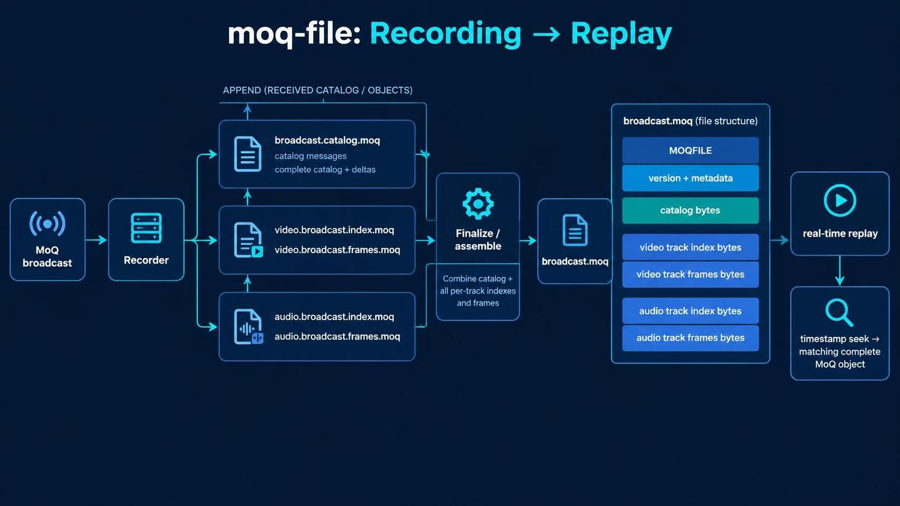

# moq-file

**moq-file** is a file format for recording a Media over QUIC (MoQ) broadcast and replaying it later. A recording preserves the catalog and complete MoQ objects, enabling real-time replay, timestamp-based seeking, and offline processing.

> **Status:** Early-stage proposal. The format and implementation may change.

## Goals

- Preserve catalog messages, including catalog updates and deltas.
- Store complete MoQ objects so a recording can be replayed.
- Support per-track indexing and timestamp seeking.
- Allow recording components to be written incrementally, then assembled into one file.

## File layout

A finalized `{broadcast_name}.moq` file contains a header, metadata, and the data sections referenced by that metadata:

```text
+----------------------------------+
| Magic: ASCII "MOQFILE"           |
+----------------------------------+
| Container version                |
+----------------------------------+
| Metadata length                  |
+----------------------------------+
| Metadata                          |
|  - Catalog format identifier     |
|  - Catalog message data          |
|  - Track identities              |
|  - Per-track section descriptors |
|    (offsets and lengths)          |
+----------------------------------+
| Per-track index and frames       |
| sections                         |
+----------------------------------+
```

The metadata identifies the catalog format and preserves catalog messages in their original order, including updates or deltas. Catalog data is treated as opaque by the container; catalog-specific parsing is left to the reader.

Each track has its own index and frames section. Section descriptors in the metadata let a reader locate them. Offsets are measured from the beginning of the finalized file.

Section offsets in the metadata are relative to the start of the data area: the byte immediately after the metadata. This lets the finalizer assemble the data sections without accounting for the header or metadata size when calculating their offsets.

## Index and frames

An index entry maps a timestamp to an object in that track’s frames section:

```text
timestamp | object offset | object length
```
The timestamp comes first. The object offset is relative to the beginning of that track’s frames section. The object length allows the reader to retrieve the complete stored object.

The frames section stores complete MoQ objects, not just media payloads. The timestamp’s units and meaning, the index entry’s binary encoding, and the on-disk encoding of complete MoQ objects must be defined by the container version.

## Recording and finalization

While recording, the recorder appends catalog messages, index entries, and complete MoQ objects to separate temporary files:

```text
{broadcast_name}.catalog.moq
{track_name}.{broadcast_name}.index.moq
{track_name}.{broadcast_name}.frames.moq
```
When the broadcast ends, the finalizer assembles the catalog, each track’s index and frames, and the metadata into:

```text
{broadcast_name}.moq
```
The metadata is written with the final section offsets and lengths. Track names used in temporary filenames must be escaped or encoded so they cannot accidentally create directories or invalid paths.

## License

This project is dual-licensed: MIT OR Apache-2.0, choose either. See LICENSE-MIT and LICENSE-APACHE-2.0 in the repository root.


